

[English](README.md) · **Türkçe**


 

## Hakkımda

- 🧊 Fotoğraflardan **3D model** üretiyorum (fotogrametri) ve **Blender**'da temizliyorum: mesh düzenleme, UV mapping, optimizasyon
- 📱 Unity ile **artırılmış gerçeklik restoran menüsü** geliştirdim: telefonu menüye tut, yemek 3D olarak karşında belirsin
- 🛡️ TryHackMe üzerinden uygulamalı **siber güvenlik** çalışıyorum: ağ temelleri, Linux/Windows terminali, Nmap, Wireshark, Metasploit
- 🧭 **İnsan-bilgisayar etkileşimi** üzerine ders aldım: UI/UX'i standartlara göre tasarlama, **Figma** ile prototipleme
- 🧑‍💻 **C, C++ ve C#** yazıyorum, **SQL** biliyorum; web tarafında React, HTML, CSS ve JavaScript kullanıyorum

 

## Teknolojiler

**3D ve AR** 

&nbsp;

**Güvenlik ve sistemler** 

&nbsp;

**Diller** 

**Web** 

 

## Siber güvenlik: TryHackMe

**Dünya genelinde ilk %9** · **60 oda tamamlandı** · **6 rozet** · **son bir yılda 1.183 etkinlik**

<table align="center">
  <tr>
    <td align="center">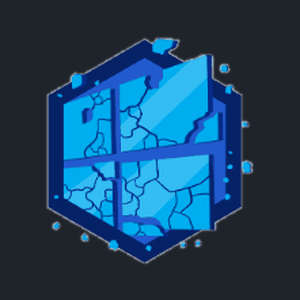 <b>Blue</b> EternalBlue ile Windows</td>
    <td align="center">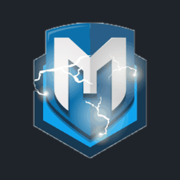 <b>Metasploitable</b> Metasploit kullanımı</td>
    <td align="center">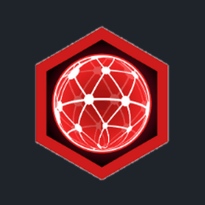 <b>Networking Nerd</b> Ağ temelleri</td>
  </tr>
  <tr>
    <td align="center">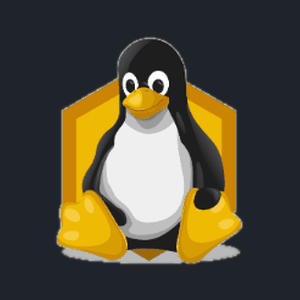 <b>cat linux.txt</b> Linux yetkinliği</td>
    <td align="center">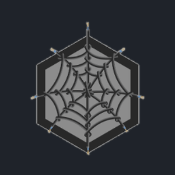 <b>Webbed</b> Web nasıl çalışır</td>
    <td align="center">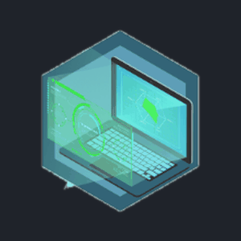 <b>World Wide Web</b> How The Web Works</td>
  </tr>
</table>

<b>Tamamlanan odalar (60)</b>

 

| Alan | Odalar |
| --- | --- |
| **Ofansif güvenlik ve araçlar** (12) | Nmap · Wireshark · Tcpdump · John the Ripper · Metasploit (3 oda) · Blue · Moniker Link · Become a Hacker · Offensive Security · Web Applications |
| **Ağ** (11) | DNS in Detail · OSI Model · Packets & Frames · Intro to LAN · HTTP in Detail · Networking Core · + 5 ağ odası daha |
| **Windows ve Active Directory** (8) | Windows Basics · Windows CLI · PowerShell · Active Directory · + 4 Windows odası daha |
| **Linux** (5) | Linux CLI Basics · Linux Shells · + 3 Linux temelleri odası |
| **Kriptografi** (5) | Hashing Basics · Data Encoding · Açık anahtarlı kriptografi · Cryptography (2 oda) |
| **Defansif güvenlik** (5) | The CIA Triad · Search Skills · Defensive Security · Careers in Cyber · + 1 oda daha |
| **Web ve programlama** (7) | Web siteleri nasıl çalışır · Putting it all together · JavaScript (2 oda) · Python · Database SQL · + 1 oda daha |
| **Bilgisayar temelleri** (7) | Computer Types · Inside a Computer · Client-Server · İşletim sistemleri (2 oda) · Virtualisation · Cloud Computing |

 

## Öne çıkan: AR Restoran Menüsü

Menüdeki QR kodu telefonla okut, yemek masanın üzerinde 3D olarak belirsin. Sipariş vermeden önce porsiyonu ve sunumu görürsün. Her yemek gerçek bir tabaktan fotoğraflanıp fotogrametri ile yeniden oluşturuldu, Blender'da temizlendi ve mobil için optimize edildi.

<table align="center">
  <tr>
    <td align="center"> Pirzola &amp; patates</td>
    <td align="center">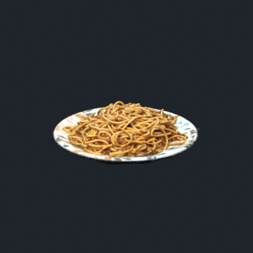 Makarna</td>
    <td align="center">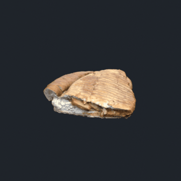 Tost</td>
  </tr>
</table>

**Unity · Vuforia · C# · Blender · RealityScan · Figma**

<b>Nasıl yaptım</b>

 

1. **Çekim:** her yemek için tabağın etrafında, farklı yüksekliklerden yaklaşık 100 fotoğraf.
2. **Yeniden oluşturma:** aynı yemeği Kiri Engine ve RealityScan ile karşılaştırdım. RealityScan daha detaylı çıktı, tüm nihai modeller onunla üretildi.
3. **Blender'da temizlik:** masayı ve fazlalık geometriyi sildim, bozuk mesh bölgelerini onardım, UV sorunlarını düzelttim.
4. **Mobil optimizasyon:** Decimate ile modelleri ~3 milyondan ~50 bin poligona, dokuları 4K'dan 2K'ya indirdim. Android'deki takılma bitti.
5. **İşaretleyici takibi:** Python ile üretilmiş QR kod, Vuforia image target olarak 5/5 algılanabilirlik puanı aldı.
6. **Arayüz tasarımı:** Figma'da tasarlayıp Unity'de kategori sekmeleri ve ileri/geri gezinmeyle kurdum.

 

## 3D çalışmalarım: fotoğraftan sırt çantaları

Gerçek sırt çantalarını hafif 3D modellere dönüştürdüm (şu ana kadar 13 tasarım). Fotogrametri nadiren tertemiz çıkar. Bu yüzden işin büyük kısmı Blender'da bozuk bölgeleri düzeltmekti: elle **mesh düzenleme**, düzgün alanların **UV haritasını** bozuk alanlara uygulama ve modeli hafif kalması için sadeleştirme.

<table align="center">
  <tr>
    <td align="center">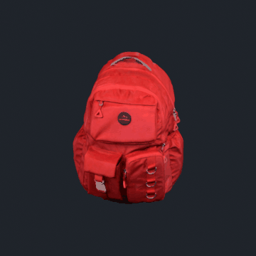</td>
    <td align="center">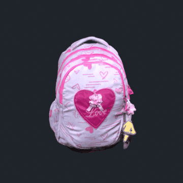</td>
    <td align="center">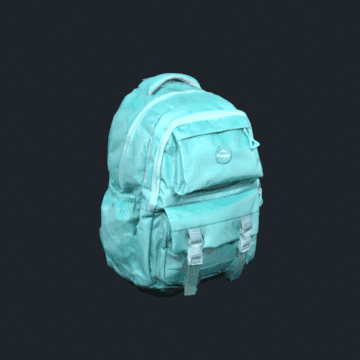</td>
  </tr>
</table>

 

## Yeteneklerim

| Alan | Neler yapıyorum |
| --- | --- |
| **3D** | Fotogrametri, mesh temizleme, UV mapping, Blender'da poligon ve doku optimizasyonu |
| **AR** | Unity + Vuforia ile işaretleyici tabanlı AR, mobil performans iyileştirme |
| **Güvenlik** | TryHackMe odaları, ağ temelleri, Nmap, Wireshark, Metasploit, Linux ve Windows komut satırı |
| **UI / UX** | Figma'da arayüz tasarımı, kullanılabilirlik ve HCI standartları, tasarımdan koda geçiş |
| **Web** | React, HTML, CSS, JavaScript |

 

## İletişim

&nbsp;&nbsp;&nbsp;

LinkedIn ya da e-posta üzerinden bana ulaşabilirsin.

